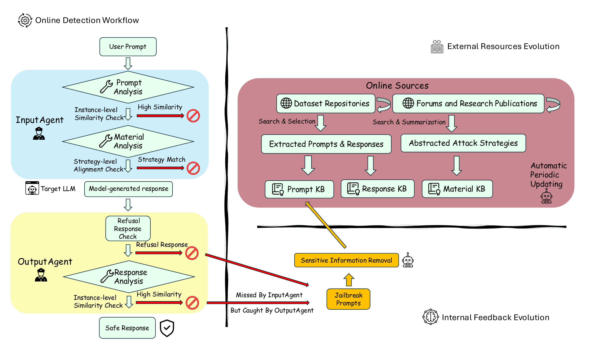

# GuardrailAgent: An Agentic Framework for Jailbreak Defense

CISPA Helmholtz Center for Information Security



GuardrailAgent is a multi-agent defense framework that provides adaptive, end-to-end protection against jailbreak attacks on large language models (LLMs). The system autonomously gathers and summarizes attack characteristics into a continuously updated knowledge base that supports both input- and output-side detection.

## Overview

GuardrailAgent adopts a two-stage online detection workflow:

- **InputAgent**: Analyzes user prompts using two knowledge-base-driven tools:
  1. **Prompt Analysis Tool** (Prompt KB) -- instance-level similarity check against known jailbreak prompts
  2. **Material Analysis Tool** (Material KB) -- strategy-level alignment check against documented attack methods
  
  The InputAgent uses a cascaded scoring mechanism: if either tool returns a high-confidence score (2), the prompt is immediately flagged. Otherwise, scores are summed -- a combined score >= 2 results in a "jailbreak" decision.

- **OutputAgent**: Monitors model-generated responses using a **Response Analysis Tool** (Response KB) that checks for characteristic jailbreak response patterns, preceded by a refusal detection step.

## Project Structure

```
GuardrailAgent/
├── main.py                  # Entry point: data loading + multiprocessing dispatch
├── model_runner.py          # Routes to InputAgent or OutputAgent based on MODULE env var
├── data/
│   ├── prompt_kb/           # Pre-built Prompt KB (Chroma, e5-base-v2)
│   └── response_kb/         # Pre-built Response KB (Chroma, e5-base-v2)
├── scripts/
│   ├── input_agent.py       # InputAgent: orchestrates Prompt KB + Material KB tools
│   ├── output_agent.py      # OutputAgent: orchestrates Response KB tool
│   ├── prompt_kb/
│   │   └── retrieval_ex_kb.py    # Prompt KB retrieval (embedchain + Chroma)
│   ├── materials_txt/
│   │   ├── retrieval.py          # Material KB retrieval (text + LLM matching)
│   │   └── gpt4.1/              # Material KB data: attack strategy summaries (31 files)
│   ├── response_kb/
│   │   └── retrieval_ex_kb.py    # Response KB retrieval (embedchain + Chroma)
│   └── prompts/
│       ├── input_agent.yaml               # InputAgent system prompt
│       ├── output_agent.yaml              # OutputAgent system prompt
│       └── material_extraction_prompt.txt # Prompt used to extract Material KB from papers
```

## Setup

1. **API Keys**: Set your API keys as environment variables:
   ```bash
   export OPENAI_API_KEY="your-openai-api-key"
   ```
   For Gemini models, update the `api_key` parameter in `scripts/input_agent.py` and `scripts/output_agent.py`.

2. **Embedding Models**: Download the required embedding model before running:
   ```bash
   mkdir -p ./hf-cache/models
   python3 -c "
   from sentence_transformers import SentenceTransformer
   model = SentenceTransformer('intfloat/e5-base-v2')
   model.save('./hf-cache/models/e5-base-v2')
   "
   ```

3. **Knowledge Bases**: Pre-built KBs are included in `data/`. Both Prompt KB and Response KB use Chroma with e5-base-v2 embeddings.

## Usage

### Environment Variables

GuardrailAgent is configured via environment variables:

| Variable | Description | Example |
|---|---|---|
| `MODULE` | Detection mode: `INPUT` or `OUTPUT` | `INPUT` |
| `MODELID` | LLM model ID for the agent | `gpt-4.1-mini` |
| `OPENAI_API_KEY` | OpenAI API key | |
| `INPUTRETRIEVALDIR` | Path to Prompt KB (Chroma) | `./data/prompt_kb` |
| `OUTPUTRETRIEVALDIR` | Path to Response KB (Chroma) | `./data/response_kb` |
| `TXTRETRIEVALDIR` | Path to Material KB text file | `./scripts/materials_txt/gpt4.1/materials_30.txt` |
| `OUTPUTDIR` | Directory to write detection results | `./output/experiment1` |
| `TAG` | Experiment tag (used in output path) | `phase30/input_test` |

### Input-side Detection

```bash
export OPENAI_API_KEY="your-key"
export MODULE="INPUT"
export MODELID="gpt-4.1-mini"
export INPUTRETRIEVALDIR="./data/prompt_kb"
export OUTPUTRETRIEVALDIR="./data/response_kb"
export TXTRETRIEVALDIR="./scripts/materials_txt/gpt4.1/materials_30.txt"
export OUTPUTDIR="./output/experiment1"
export TAG="input_test"

python main.py --input path/to/dataset.json --workers 4
```

### Output-side Detection

```bash
export MODULE="OUTPUT"
# Other variables same as above

python main.py --input path/to/dataset.json --workers 4
```

### Command-line Arguments

| Argument | Description | Default |
|---|---|---|
| `--input` | Path to input JSON file (required) | |
| `--limit` | Only process first N items | All |
| `--workers` | Number of parallel workers | Auto-detected |

### Input Data Format

The input JSON file should contain an array of objects:

```json
[
  {
    "id": 1,
    "text": "the user prompt to check",
    "response": "the model-generated response (used in OUTPUT mode)"
  }
]
```

- **INPUT mode**: uses `text` (or `prompt`) field for detection
- **OUTPUT mode**: uses `response` field for detection

## Knowledge Bases

| KB | Format | Embedding Model | Used By |
|---|---|---|---|
| Prompt KB | Chroma | intfloat/e5-base-v2 | InputAgent (Prompt Analysis Tool) |
| Material KB | Plain text | N/A (LLM-based matching) | InputAgent (Material Analysis Tool) |
| Response KB | Chroma | intfloat/e5-base-v2 | OutputAgent (Response Analysis Tool) |

## Evaluation Datasets

For reproducibility, we evaluate on the following publicly available datasets:

- **JailbreakRadar** ([Chu et al., 2025](https://github.com/TrustAIRLab/JailbreakRadar)) -- a benchmark covering 10+ representative jailbreak attack strategies
- **WildJailbreak** ([Jiang et al., 2024](https://huggingface.co/datasets/allenai/wildjailbreak)) -- in-the-wild jailbreak prompts

Please obtain these datasets from their original sources.

## Note

The code for automated knowledge base construction and feedback-driven updates is currently being organized and will be released soon.

## Ethical Considerations

This repository is intended for research on jailbreak defense only. The knowledge bases contain jailbreak prompts and harmful model outputs, so please use them responsibly and do not use them to attack real systems or generate harmful content.

## Citation

```bibtex
@inproceedings{CCWBZ26,
  author = {Tianze Chang and Junjie Chu and Yixin Wu and Michael Backes and Yang Zhang},
  title = {{GuardrailAgent: An Agentic Framework for Jailbreak Defense}},
  booktitle = {{Findings of the Association for Computational Linguistics: EMNLP}},
  publisher = {ACL},
  year = {2026}
}
```

## License

The code in this repository is released under the [MIT License](LICENSE). Third-party datasets and other external resources are subject to their own licenses and terms.

